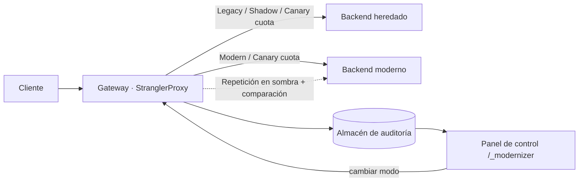

# NainLegacyModernizer

> Arnés de modernización sin tiempo de inactividad para cargas de trabajo heredadas de .NET: una pasarela YARP que traslada cada ruta a través de
> **Legacy → Shadow → Canary → Modern**, verifica la paridad con tráfico real y lo muestra todo en un panel de control interactivo.

[](README.md)
[](#)
[](docs/02-architecture.md)
[](https://dotnet.microsoft.com/)
[](https://microsoft.github.io/reverse-proxy/)
[](docs/00-charter.md)

**[Demostración en vivo](https://modernizer.naindev.com/)**: una ilustración interactiva sin backend del enrutamiento Strangler Fig y la ejecución en sombra (código fuente en [`demo/`](demo/)).

## Pruébalo en un solo comando

```bash
dotnet run --project src/NainLegacyModernizer.Demo
```

Abre <http://127.0.0.1:8080/_modernizer>, pulsa **Enviar 50 peticiones** dos veces y observa:

- **Panel de migración**: cada ruta en su etapa actual, con muestras, paridad, latencia heredada frente a moderna y etiqueta de preparación. Promueve con un clic cuando indique **Ready**; revierte con la misma rapidez.
- **Auditorías de paridad**: cada petición en sombra comparada campo a campo. La demo incluye una diferencia de redondeo de IVA en `customers` para inspeccionar la comparativa en paralelo.
- **Tráfico en vivo**: qué servicio atendió cada petición, estado y latencia, transmitidos vía SSE.
- Temas claro y oscuro, español e inglés, sin paso de compilación pesado y sin recursos externos.

## Cómo funciona



| Modo | Petición atendida por | Qué más ocurre |
| :--- | :--- | :--- |
| `Legacy` | heredado | nada: migración no iniciada |
| `Shadow` | heredado | misma petición repetida en paralelo al moderno, cuerpos comparados, auditoría registrada |
| `Canary` | heredado o moderno (% configurado) | porcentaje de tráfico real atendido por la nueva arquitectura |
| `Modern` | moderno | el monolito ya no interviene en la ruta |

## Uso en tus propios sistemas

Edita la sección `Modernizer` de [appsettings.json](src/NainLegacyModernizer.Gateway/appsettings.json): las dos direcciones base y una entrada por ruta (`PathPattern`, `Mode`, `CanaryPercent`, `FieldAliases` para propiedades renombradas, `IgnoredFields` para metadatos generados, `SampleRequests` para el generador de tráfico de prueba). Después, ejecuta la pasarela:

```bash
dotnet run --project src/NainLegacyModernizer.Gateway
```

Detalles, límites y modos de fallo: [docs/10-runbook.md](docs/10-runbook.md).

## Informe de paridad: ¿está la ruta lista para el corte definitivo?

Apunta `nain-parity` a tu sistema heredado y a tu nueva implementación. Envía las mismas peticiones `GET` a ambos, compara el JSON y genera un informe HTML autónomo. El código de salida actúa como puerta de enlace en CI (`0` lista, `1` con discrepancias, `2` argumentos incorrectos).


```bash
dotnet run --project src/NainLegacyModernizer.ParityCli -- \
  --legacy https://legacy.example.com --modern https://new.example.com \
  --paths paths.txt --map OrderID=id --ignore generatedAt --out report.html
```

- Comparación insensible a mayúsculas/minúsculas, `_` y `-`. `--map old=new` alinea campos renombrados. `--ignore` omite campos irrelevantes.
- Los números se comparan como decimales de precisión fija (`450.5` equivale a `450.50`), nunca como coma flotante.
- Solo lectura: únicamente peticiones `GET`. Verifica que tus puntos finales no tengan efectos secundarios.
- Informes de muestra generados a partir de los servicios del repositorio: [no listo](demo/samples/parity-report-not-ready.html), [listo](demo/samples/parity-report-ready.html).

## Estructura de la solución

| Proyecto | Responsabilidad |
| :--- | :--- |
| `Core` | Modos de migración, rutas, política de corte, modelo de paridad e informe |
| `ShadowRunner` | Comparador de paridad en sombra, auditor tolerante a fallos, almacén en memoria, comparador JSON y renderizador HTML |
| `Gateway` | Reenvío YARP, enrutamiento por petición, repetición en sombra, API del panel de control e interfaz integrada |
| `ParityCli` | Herramienta de consola `nain-parity` y puerta de CI (códigos de salida deterministas) |
| `LegacyMonolith` / `ModernApi` | Implementaciones de demostración (PascalCase lenta vs camelCase rápida) |
| `Demo` | Los tres servicios empaquetados en un único proceso |
| `Tests` | Pruebas unitarias, pruebas de arquitectura y pruebas de integración en memoria |

## Verificación

```bash
dotnet test
```

Mapa de documentación: [docs/README.md](docs/README.md).

---

**Autor**: Aitor Nain Mendoza Vallejo  
**Estándares**: [NainDev Engineering Handbook](https://github.com/Nain9Dev/engineering-handbook)
