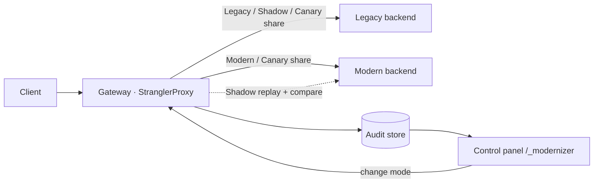
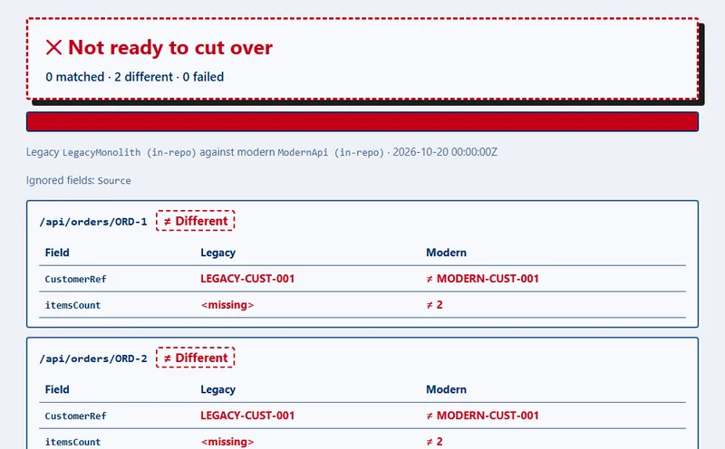
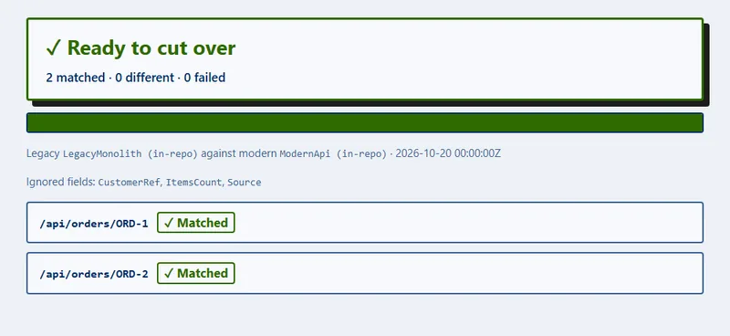

# NainLegacyModernizer

> Zero-downtime modernization harness for legacy .NET workloads: a YARP gateway that moves each route through
> **Legacy → Shadow → Canary → Modern**, verifies parity on real traffic and shows it all in a control panel a client can drive.

[](#)
[](README.es.md)
[](docs/02-architecture.md)
[](https://dotnet.microsoft.com/)
[](https://microsoft.github.io/reverse-proxy/)
[](docs/00-charter.md)

**[Live demo](https://modernizer.naindev.com/)**: an interactive, no-backend illustration of the Strangler Fig routing and the shadow run (source in [`demo/`](demo/)).

## Try it in one command

```bash
dotnet run --project src/NainLegacyModernizer.Demo
```

Open <http://127.0.0.1:8080/_modernizer>, press **Send 50 requests** twice and watch:

- **Migration board**: every route on its stage, with samples, parity, legacy vs modern latency and a readiness badge.
  Promote with one click when it says **Ready**; roll back just as fast.
- **Parity audits**: each shadowed request compared field by field. The demo ships a VAT rounding difference on
  `customers` so you can open one and see the side-by-side diff.
- **Live traffic**: who served each request, status and latency, streamed over SSE.
- Light and dark themes, English and Spanish, no build step, no external assets.

## How it works



| Mode | Caller served by | What else happens |
| :--- | :--- | :--- |
| `Legacy` | legacy | nothing: not started |
| `Shadow` | legacy | same request replayed to modern, bodies compared, audit recorded |
| `Canary` | legacy or modern (configured %) | real traffic share on the new stack |
| `Modern` | modern | monolith no longer involved |

## Use it with your own systems

Edit the `Modernizer` section of [appsettings.json](src/NainLegacyModernizer.Gateway/appsettings.json): the two base
addresses and one entry per route (`PathPattern`, `Mode`, `CanaryPercent`, `FieldAliases` for renamed properties,
`IgnoredFields` for generated metadata, `SampleRequests` for the demo traffic button). Then run the gateway alone:

```bash
dotnet run --project src/NainLegacyModernizer.Gateway
```

Details, limits and failure modes: [docs/10-runbook.md](docs/10-runbook.md).

## Parity report: is this route ready to cut over?

Point `nain-parity` at your legacy system and your new implementation. It sends the same `GET` requests to both, compares the JSON, and writes one self-contained HTML report. The exit code makes it a CI gate (`0` ready, `1` not ready, `2` bad arguments).




```bash
dotnet run --project src/NainLegacyModernizer.ParityCli -- \
  --legacy https://legacy.example.com --modern https://new.example.com \
  --paths paths.txt --map OrderID=id --ignore generatedAt --out report.html
```

- Names match ignoring case, `_` and `-`. `--map old=new` aligns renamed fields. `--ignore` skips fields (the report lists them).
- Numbers compare as decimals (`450.5` equals `450.50`), never as floating point.
- Read-only: only `GET`. Authentication headers are not supported yet. Check that your `GET` endpoints have no side effects.
- Git Bash on Windows rewrites arguments that start with `/`. Use a `--paths` file or set `MSYS_NO_PATHCONV=1`.
- Sample reports, generated from the in-repo services: [not ready](demo/samples/parity-report-not-ready.html), [ready](demo/samples/parity-report-ready.html).

## Solution layout

| Project | Role |
| :--- | :--- |
| `Core` | Migration modes, routes, cutover policy, parity model, parity report model |
| `ShadowRunner` | Shadow parity comparer, fault-tolerant auditor, in-memory audit store; parity runner, JSON comparer and HTML renderer for the CLI |
| `Gateway` | YARP forwarding, per-request routing, shadow replay, control panel API and embedded UI |
| `ParityCli` | `nain-parity` console tool and CI gate (exit codes) |
| `LegacyMonolith` / `ModernApi` | Demo stand-ins (PascalCase and slow vs camelCase and fast) |
| `Demo` | All three hosts in one process |
| `Tests` | Unit tests plus in-memory gateway integration tests |

## Verify

```bash
dotnet test
```

Documentation map: [docs/README.md](docs/README.md).

---

**Author**: Aitor Nain Mendoza Vallejo
**Standards**: [NainDev Engineering Handbook](https://github.com/Nain9Dev/engineering-handbook)
