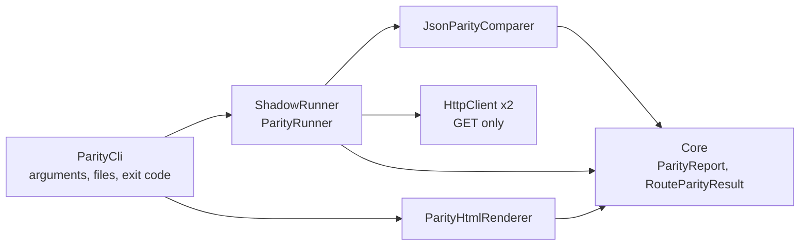

# System Architecture: NainLegacyModernizer

## 1. Topological C4 Container Blueprint

```mermaid
flowchart TB
    classDef client fill:#0284c7,stroke:#0369a1,color:#fff;
    classDef proxy fill:#0047AB,stroke:#38bdf8,stroke-width:2px,color:#fff;
    classDef modern fill:#059669,stroke:#34d399,color:#fff;
    classDef legacy fill:#475569,stroke:#94a3b8,color:#fff;
    classDef shadow fill:#d97706,stroke:#f59e0b,color:#fff;

    caller[Client Application / Web Frontend]:::client
    yarp[YARP Gateway<br/>.NET 10 Reverse Proxy]:::proxy
    modernApi[ModernApi (.NET 10)<br/>Carved-out Orders Context]:::modern
    legacyApi[LegacyMonolith (.NET Framework 4.8 / MVC 5)<br/>Legacy Invoices & Fallbacks]:::legacy
    shadowAuditor[ShadowRunner<br/>Audit Queue & Discrepancy Detector]:::shadow

    caller -->|All Traffic /api/*| yarp
    yarp -->|Route: /api/orders/*| modernApi
    yarp -->|Catch-all fallback /*| legacyApi

    caller -.->|Shadow Write Mode| shadowAuditor
    shadowAuditor -->|Async Primary Exec| legacyApi
    shadowAuditor -->|Async Shadow Exec| modernApi
    shadowAuditor -->|100% Parity Assertion| shadowAuditor
```

## 2. Component Responsibility Matrix

| Project | Responsibility | Framework & Pattern |
| :--- | :--- | :--- |
| `NainLegacyModernizer.Gateway` | Intelligent reverse proxy routing incoming traffic by path pattern | .NET 10, YARP (Yet Another Reverse Proxy) |
| `NainLegacyModernizer.ModernApi` | High-throughput, clean architecture implementation of the carved slice | .NET 10, ASP.NET Core, CQRS |
| `NainLegacyModernizer.LegacyMonolith` | High-fidelity emulation of legacy monolith behaviors and schemas | .NET 10 (emulating .NET 4.8 / MVC 5 contracts) |
| `NainLegacyModernizer.ShadowRunner` | Audit harness comparing legacy vs modern domain execution | .NET 10, Concurrent Pipeline |
| `NainLegacyModernizer.ShadowRunner` (parity) | JSON comparer, HTTP runner and HTML report renderer for any pair of APIs | .NET 10, BCL only |
| `NainLegacyModernizer.ParityCli` | `nain-parity` console tool and CI gate (exit codes) | .NET 10, `PackAsTool` |
| `NainLegacyModernizer.Tests` | Integration verification of proxying, fallback, and discrepancy audits | xUnit, Microsoft.AspNetCore.Mvc.Testing |

## 3. Parity Report Flow



`Core` holds only the report models (no HTTP, no JSON). Comparison, HTTP and rendering live in `ShadowRunner`; the CLI does I/O and exit codes only.
