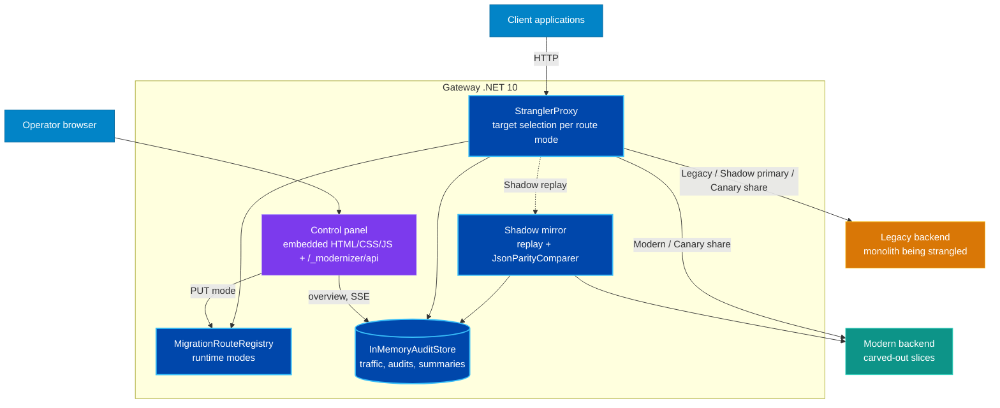

# System Architecture: NainLegacyModernizer

## 1. Container view

## 2. Request flow per mode

| Mode | Caller is served by | Modern backend | Audit recorded |
| :--- | :--- | :--- | :--- |
| `Legacy` | legacy | not called | traffic sample |
| `Shadow` | legacy | replayed after the response is flushed | traffic sample + parity audit |
| `Canary` | legacy or modern (configured %) | serves its share | traffic sample |
| `Modern` | modern | serves everything | traffic sample |

Unmatched paths behave as `Legacy` under the synthetic route id `legacy-fallback`.

## 3. Component responsibility matrix

| Project | Responsibility | Notes |
| :--- | :--- | :--- |
| `NainLegacyModernizer.Core` | Domain: migration modes and routes, cutover policy, parity model, summaries, demo sample data | No references to HTTP or serialization |
| `NainLegacyModernizer.ShadowRunner` | `JsonParityComparer`, fault-tolerant `ShadowAuditor`, `InMemoryAuditStore` with change notifications | Reusable outside the gateway |
| `NainLegacyModernizer.Gateway` | YARP `IHttpForwarder` proxying, per-request target selection, shadow capture and replay, control panel API and embedded UI | Configured through the `Modernizer` section |
| `NainLegacyModernizer.LegacyMonolith` | Demo stand-in for the system being strangled (PascalCase, stringified decimals, slow) | Replace with the real system |
| `NainLegacyModernizer.ModernApi` | Demo stand-in for the rewritten slices (camelCase, typed domain, fast) | Replace with the real system |
| `NainLegacyModernizer.Demo` | Runs the three hosts in one process for demos | Not for production |
| `NainLegacyModernizer.Tests` | Unit tests plus in-memory gateway integration tests | No sockets |

## 4. Presentation boundary

The control panel (`Gateway/Panel`) only renders what `/_modernizer/api` returns and sends the operator's intent back
(`PUT /routes/{id}/mode`). Parity ratios, readiness and latency percentiles are computed server side (`Core` and
`ShadowRunner`), never in the browser.
