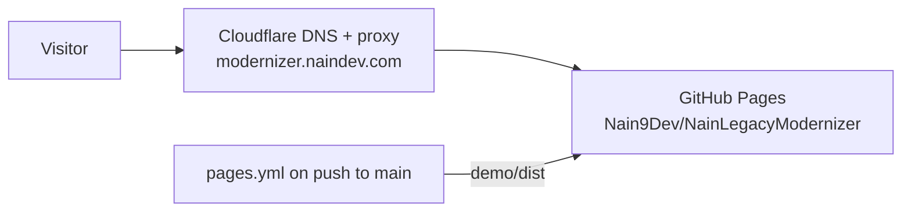

# Operational Runbook: NainLegacyModernizer

## 1. Prerequisites

- .NET 10 SDK (`dotnet --version` >= 10.0.100)

## 2. Standard Commands

```bash
# Restore dependencies
dotnet restore

# Build entire solution with zero warnings
dotnet build --configuration Release

# Execute test suite
dotnet test --configuration Release
```

## 3. Demo Hosting

The static demo (`demo/`) is deployed by `.github/workflows/pages.yml` to GitHub Pages and served at
`https://modernizer.naindev.com/`, the same pattern as the other NainDev projects:



- **Deploy**: push to `main` touching `demo/**` runs build, test and deploy. Pull requests only build and test.
- **Domain**: the custom domain is a Pages setting (`cname`), not a `CNAME` file, because the site is deployed
  from a workflow. DNS is a Cloudflare record pointing the subdomain at `nain9dev.github.io`.
- **Cost**: 0.00 EUR (GitHub Pages and Cloudflare free plan).
- **Rollback**: re-run the workflow on a previous commit, or revert the change on `main`.
- **Check**: `curl -sI https://modernizer.naindev.com/` answers `200`.

## 4. Failure Mode Recovery

- **Routing Failure**: If a migrated route returns 404 through YARP, check `appsettings.json` in `NainLegacyModernizer.Gateway` to verify route prefix matching and cluster destinations.
- **Shadow Discrepancy**: If `ShadowAuditor` reports mismatches, inspect the generated discrepancy report payload for precision or casing differences.
