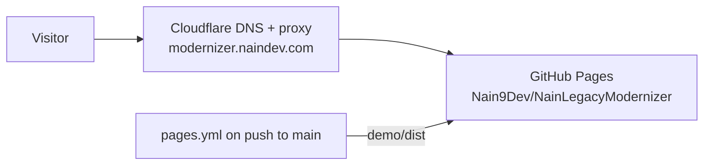

# Operational Runbook: NainLegacyModernizer

## 1. Prerequisites

- .NET 10 SDK (`dotnet --version` >= 10.0.100). Nothing else: no Node, no database, no containers.

## 2. One-command demo

```bash
dotnet run --project src/NainLegacyModernizer.Demo
```

Then open <http://127.0.0.1:8080/_modernizer>. The demo starts three hosts in one process:

| Host | URL | Role |
| :--- | :--- | :--- |
| Gateway + control panel | `http://127.0.0.1:8080` | entry point for clients and operators |
| Legacy monolith (stand-in) | `http://127.0.0.1:5000` | system being strangled |
| Modern API (stand-in) | `http://127.0.0.1:5001` | rewritten slices |

Suggested walkthrough for a client: press **Send 50 requests** twice, watch `orders` reach **Ready**, promote it to
**Modern** (one confirmation), open a `customers` audit to show the VAT rounding bug the shadow run caught, drag the
`catalog` canary slider.

## 3. Pointing the harness at a real system

Everything lives in the `Modernizer` section of `src/NainLegacyModernizer.Gateway/appsettings.json`
(or environment variables such as `Modernizer__LegacyBaseAddress`):

| Key | Meaning |
| :--- | :--- |
| `LegacyBaseAddress`, `ModernBaseAddress` | absolute URLs of both backends |
| `Routes[]` | `Id`, `PathPattern` (`/api/orders/{**rest}`), `Mode`, `CanaryPercent`, `FieldAliases`, `IgnoredFields`, `SampleRequests` |
| `Cutover.MinimumSamples`, `Cutover.MinimumParityRatio` | readiness rule shown on the board |
| `DecimalTolerance` | absolute numeric tolerance for the comparer (0 = exact) |
| `MaxCapturedBodyBytes` | bodies above this are not compared (audit becomes `ExecutionError`) |
| `ShadowTimeoutSeconds` | budget for the modern replay |
| `AwaitShadowReplay` | `true` makes the replay synchronous (tests, scripted audits) |
| `EmitDiagnosticHeaders` | adds `X-Modernizer-Mode` / `X-Modernizer-Target` |
| `StoreCapacity` | ring-buffer size for traffic and audits |

Run the gateway alone with `dotnet run --project src/NainLegacyModernizer.Gateway` once the addresses point at the
client's systems.

## 4. Standard commands

```bash
dotnet build --configuration Release
dotnet test --configuration Release
```

## 5. Static demo hosting

The static demo (`demo/`) is deployed by `.github/workflows/pages.yml` to GitHub Pages and served at
`https://modernizer.naindev.com/`, the same pattern as the other NainDev projects:



- **Deploy**: push to `main` touching `demo/**` runs build, test and deploy. Pull requests only build and test.
- **Domain**: the custom domain is a Pages setting (`cname`), not a `CNAME` file, because the site is deployed
  from a workflow. DNS is a Cloudflare record pointing the subdomain at `nain9dev.github.io`.
- **Cost**: 0.00 EUR (GitHub Pages and Cloudflare free plan).
- **Rollback**: re-run the workflow on a previous commit, or revert the change on `main`.
- **Check**: `curl -sI https://modernizer.naindev.com/` answers `200`.

## 6. Failure modes

- **Route served by the wrong side**: check the `X-Modernizer-Mode` / `X-Modernizer-Target` response headers, then the
  route's `PathPattern` (most specific pattern wins; literals beat parameters).
- **Audit shows `ExecutionError`**: open it in the panel; the modern observation carries the reason (unreachable,
  timeout, capture limit). The caller was never affected.
- **Unexpected discrepancies**: add generated fields (`ServedAt`, ids, source markers) to `IgnoredFields` and renamed
  properties to `FieldAliases`; use `DecimalTolerance` only when the business accepts the difference.
- **Panel shows no routes**: the gateway found no `Modernizer:Routes`; verify the content root contains `appsettings.json`.

## 7. Known limits

- Modes and audits are in memory; restarting the gateway returns to the configured modes.
- No authentication on `/_modernizer`: keep it inside the client's network.
- Canary selection is random per request (no sticky sessions).
