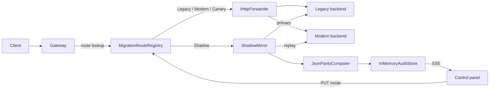

# Plan: Migration Control Panel

## Modules

| Module | Project | Covers |
| :--- | :--- | :--- |
| `Migration/*` (MigrationMode, MigrationRoute, SampleRequest, CutoverPolicy) | Core | FR1, FR9 |
| `Parity/*` (ParityVerdict, DiscrepancyDetail, ShadowAuditResult, TrafficSample, RouteSummary) | Core | FR5, FR12 |
| `JsonParityComparer` | ShadowRunner | FR7 |
| `ShadowAuditor` (parallel, fault tolerant) | ShadowRunner | FR5, FR8 |
| `IAuditStore` / `InMemoryAuditStore` (bounded, summaries, change notifications) | ShadowRunner | FR11, FR12 |
| `ModernizerOptions`, `MigrationRouteRegistry` | Gateway | FR1, FR10 |
| `StranglerProxy` (IHttpForwarder + target selection + shadow mirror) | Gateway | FR2-FR6, FR8, FR14 |
| `ControlPanelEndpoints` (`/_modernizer/api/*`, SSE) | Gateway | FR10-FR13 |
| `wwwroot/_modernizer` (static panel, no build step) | Gateway | FR12, FR13 |
| `Demo` host (legacy + modern + gateway in one process) | Demo | acceptance |

## Flow

## Key decisions

- **Own routing on top of `IHttpForwarder`** instead of YARP config routes: per-request target selection
  (canary percentage, runtime mode switch, shadow capture) is not expressible in static YARP routes. YARP still does
  the heavy lifting (streaming, header handling, HTTP/2). ADR-0001.
- **Static panel without a build step** (HTML + CSS + ES modules): keeps the "zero external dependencies" charter
  (NFR-03) and lets the gateway serve the panel from `wwwroot`. Vue 3 remains the choice if the panel grows into an
  application with routing and auth. ADR-0002.
- **In-memory bounded store**: the harness is a verification tool, not a log system. Capacity is configurable.
- **Demo host** composes the three web apps in one process so the client runs one command.

## Test strategy

- Unit: comparer rules, cutover policy, store summaries, auditor fault handling.
- Integration: gateway host with `WebApplicationFactory`; legacy and modern hosts are also `TestServer`s and their
  handlers are injected into the forwarder so no sockets are opened in CI.
