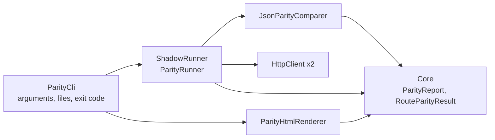

# Plan: Parity report and CLI

## Layers

- `Core`: `RouteParityResult`, `ParityReport` (counts and `IsReadyToCut`). No HTTP, no JSON.
- `ShadowRunner`: `JsonParityOptions` (ignore set, name map), `JsonParityComparer`, `ParityRunner`
  (takes two `HttpClient`, so tests use a fake handler), `ParityHtmlRenderer`.
- `ParityCli`: `CliOptions.Parse` (pure, tested), `Program` (I/O only). Packaged as a .NET tool
  (`PackAsTool`, command `nain-parity`); publishing is out of scope.

## Decisions

- Comparer works on `System.Text.Json` nodes; numbers go through `decimal.TryParse` with invariant
  culture, so no floating point.
- Field normalisation: lower case, drop `_` and `-`. Map and ignore names are normalised the same way.
- Arrays compare by index. Different lengths report the extra elements as `<missing>`.
- The renderer writes plain HTML and inline CSS with the brandbook token values, no script.
- Sample report: generated by an integration test that runs both in-repo services in memory with a
  fixed timestamp, so it is reproducible and diffable.
- No new package: `Directory.Packages.props` is unchanged.

## Risks

- `GET` on a live legacy system can still have side effects in badly designed APIs. The README says so.
- Reports can contain real business data; they are written locally and never uploaded.
